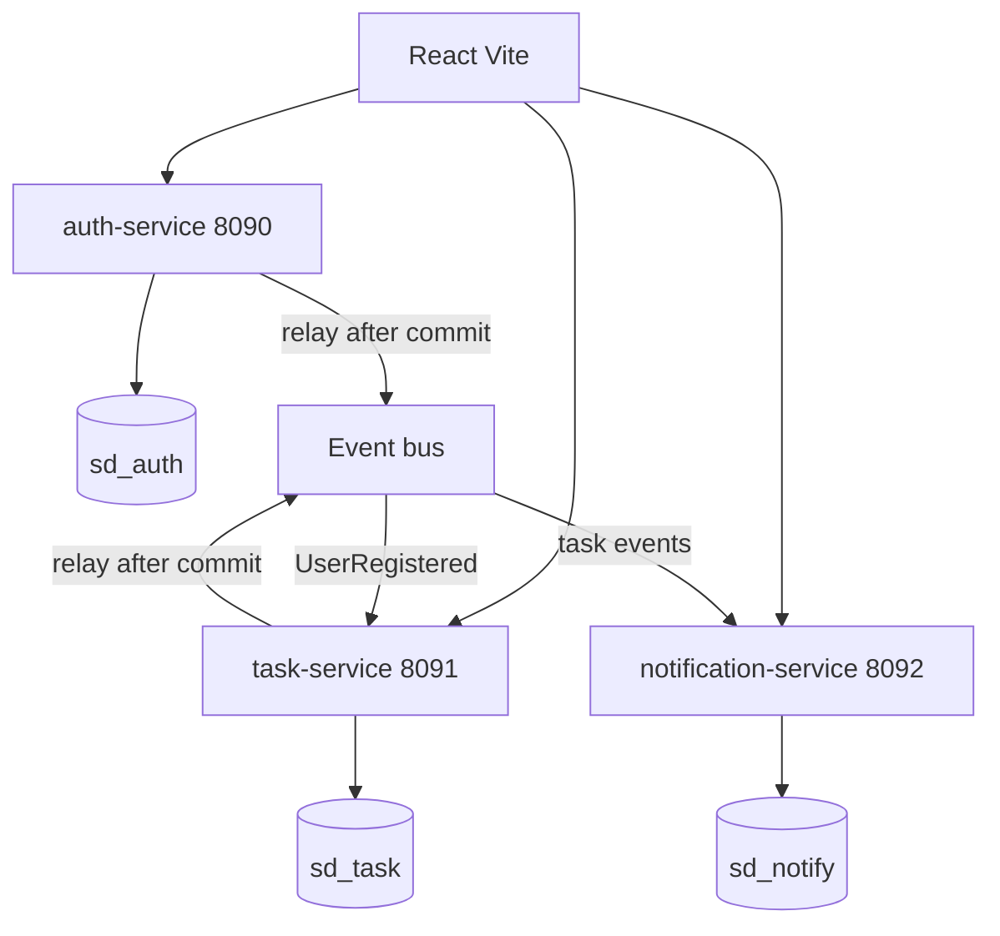
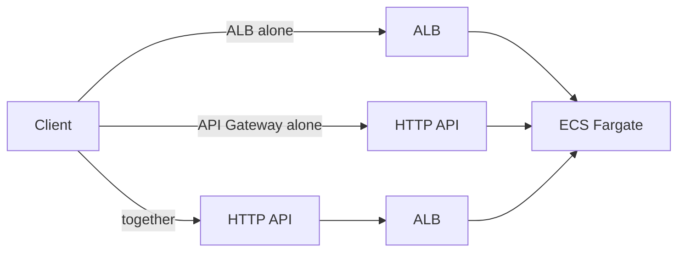

# Architecture

Three services, three databases. A task row and a notification row never share a transaction. Each service commits only its own database. When a write in one service must show up in another, the first service stores an outbox row in the same commit as the business row. A relay publishes that row after commit. The consumer writes the second database and ignores a delivery it has already applied.

This is the persistence model for separate databases and for shards. The local row is durable when the request returns. The other database becomes durable later. That gap is expected.

## Runtime



Locally the bus is Postgres database `sd_bus` (`messages`, `dead_letters`). In AWS the bus is EventBridge routing into SQS, with a dead-letter queue after 5 receives. The services talk to a small publish/receive interface, so the HTTP code does not change between the two.

Ports and database names are offset from the sister repo `zifo`, which already uses 8080/8081 and databases `auth` and `task` on this machine.

## Write path

```mermaid
sequenceDiagram
  participant UI
  participant Task
  participant TaskDb
  participant Bus
  participant Note
  participant NoteDb
  UI->>Task: PATCH status
  Task->>TaskDb: update task and insert outbox
  Task-->>UI: 200 task saved
  Task->>Bus: relay publishes after commit
  Note->>Bus: receive
  Note->>NoteDb: audit and notification if event id is new
  Note->>Bus: delete message
```

- Register commits `users` and a `UserRegistered` outbox row together. The task service upserts `user_directory` from that event. Until the row exists, assign returns 409.
- Creating a task upserts the caller's directory row from the JWT, so the owner does not wait for the event.
- Assign reads `user_directory` only. It does not call auth. The assignee change and the outbox row commit together.
- Status values are `todo`, `in_progress`, and `done`. Owner and assignee may change status. Only the owner may delete. Anyone else gets 404. An assignee who tries to delete gets 403, because they can already see the task.
- `tasks.version` increments on every change. A stale version returns 409.

Shard key, added in a later phase: `hash(owner_id) % N`. Status and assign stay on one shard. Changing owner is two commits (insert on the destination shard, then mark the source row moved). "Assigned to me" reads every shard.

## Tokens

Access token: HS256 JWT, about 15 minutes, claims `sub`, `email`, `name`, `exp`. Each service checks it locally with the shared `JWT_SECRET`. A shared HMAC secret means any service could sign a token. This project accepts that, same as zifo.

Refresh token: random string, about 7 days, stored as a SHA-256 hash. Login and refresh rotate it. The raw value is an HttpOnly cookie on `/api/auth`. The task service never sees it.

## Reliability pieces

- Outbox lease: `locked_by`, `locked_until`, claimed with `FOR UPDATE SKIP LOCKED`. A crashed relay stops holding the row when the lease time passes.
- Relay backoff: `min(60s, 0.5s * 2^attempts) * random(0.5, 1.0)`.
- Consumer idempotency: `processed_events.event_id` primary key. A second delivery does not insert a second notification.
- `Idempotency-Key` on create and assign, stored in the task database.
- Rate limit: 60 writes per minute per user, in memory, in that process only. API Gateway throttling is the multi-instance control, and it is not in effect until a deploy.
- `/health` does not touch the database. `/ready` runs `SELECT 1`.
- On SIGTERM the relay stops claiming and finishes the publish it already started.

## AWS edges

These are notes for a manual setup. No AWS resources have been created from this repo.



- **ALB alone.** Path rules and target health checks. It does not check the JWT and it does not throttle per user.
- **API Gateway alone.** HTTP API in front of Cloud Map on the ECS services, via a VPC link. Route throttling lives here. The JWT authorizer speaks OIDC (issuer plus JWKS). These services sign HS256 with a shared secret, so that authorizer does not validate the tokens this app issues. The services keep checking the token themselves.
- **Together.** HTTP API, then the same ALB. Throttle at the edge, health checks at the load balancer. Extra hop, extra cost, extra latency.
- **EventBridge** routes by detail-type to SQS. The outbox remains the source of the event. The bus is a copy.
- **ECS Fargate** is the first compute target. Tasks use public subnets and a public IP so they can pull images without a NAT gateway. The worker command is the notification consumer.
- **EKS** runs that same consumer image later. The control plane is a separate hourly charge. Manifests are in the repo. A cluster is not created unless you approve it.
- **RDS** is one instance with separate databases. That is logical isolation, not a second failure domain. A single-AZ instance has no standby. Backups and a restore have not been run.
- **CloudWatch** holds logs and alarms for ALB 5xx and DLQ depth.
- **Secrets Manager** holds database URLs and `JWT_SECRET`.
- **IAM** task roles name the queue and secret ARNs they need.

High availability is not claimed. Desired count, Multi-AZ, and autoscaling are descriptions until they are created by hand and a failover or scale-out has been observed.

## Assumptions

- Local Postgres is already running, as it is for zifo. Docker Compose is optional.
- One Postgres server hosts every database. Shard databases are still separate databases.
- No email delivery. Notifications are rows in `sd_notify`.
- No two-phase commit across databases.
- Region used in examples: `ap-southeast-2`.
